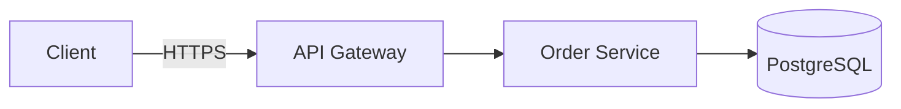
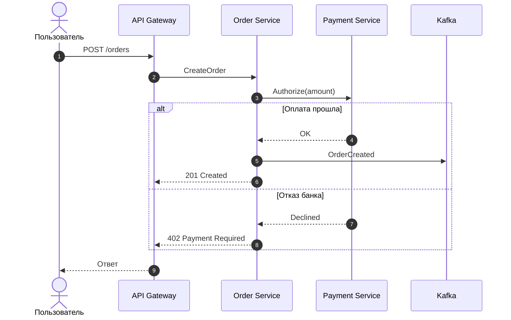
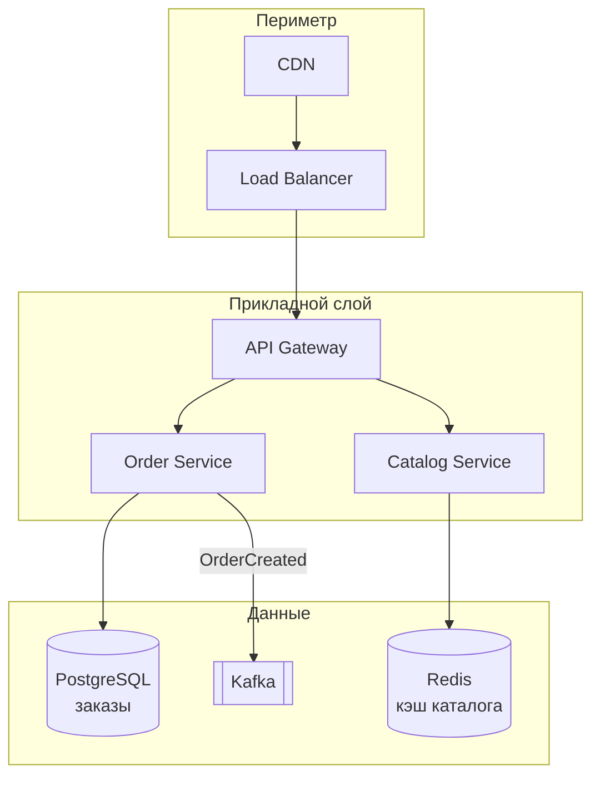
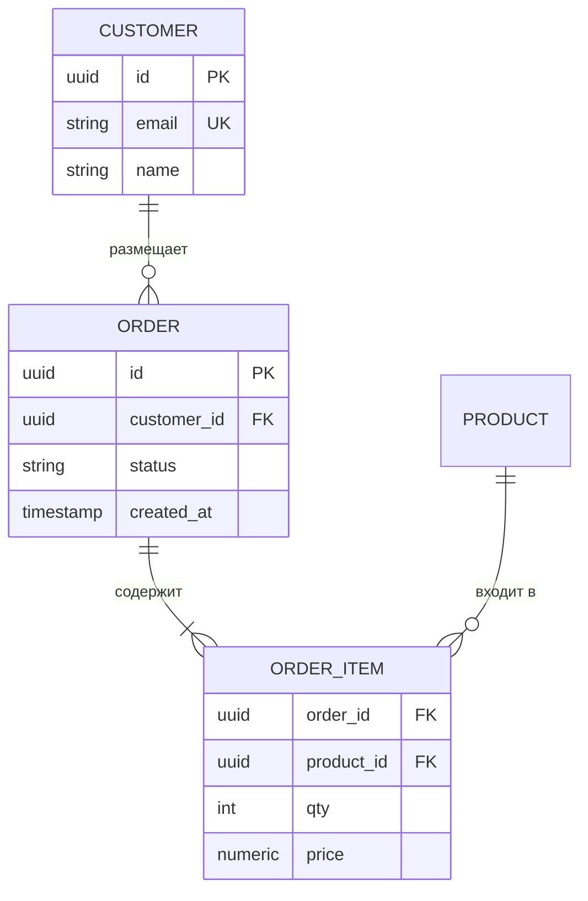
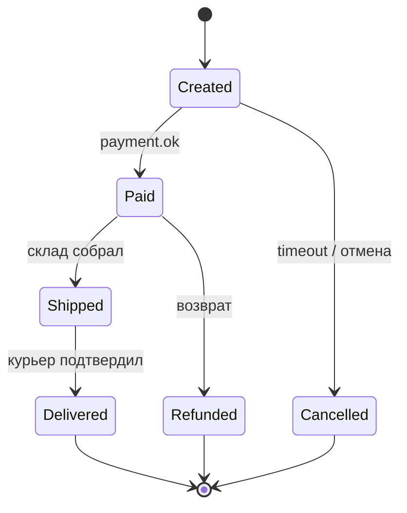
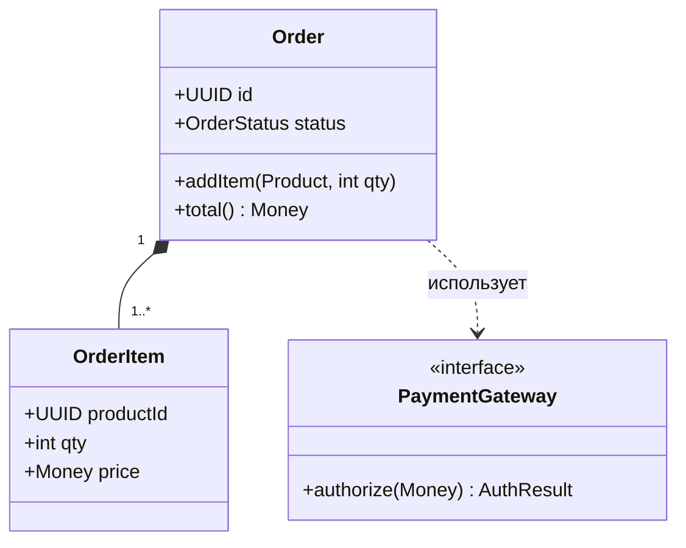
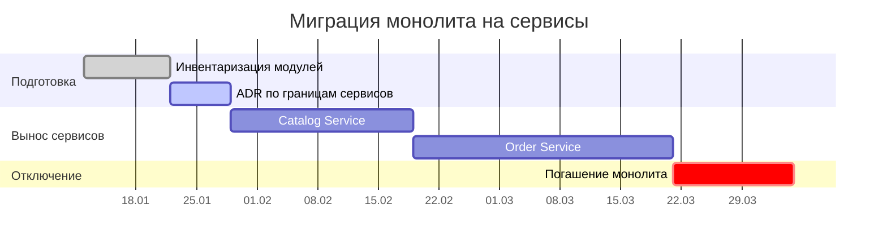
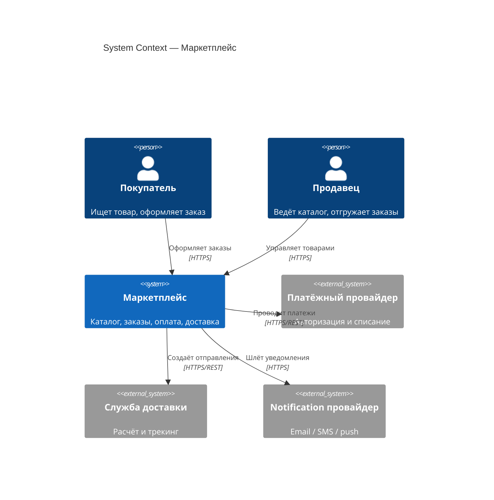
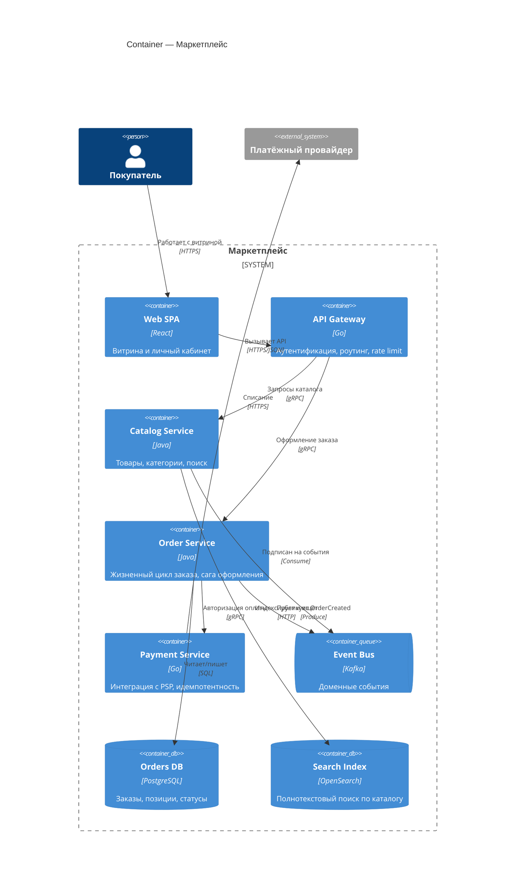
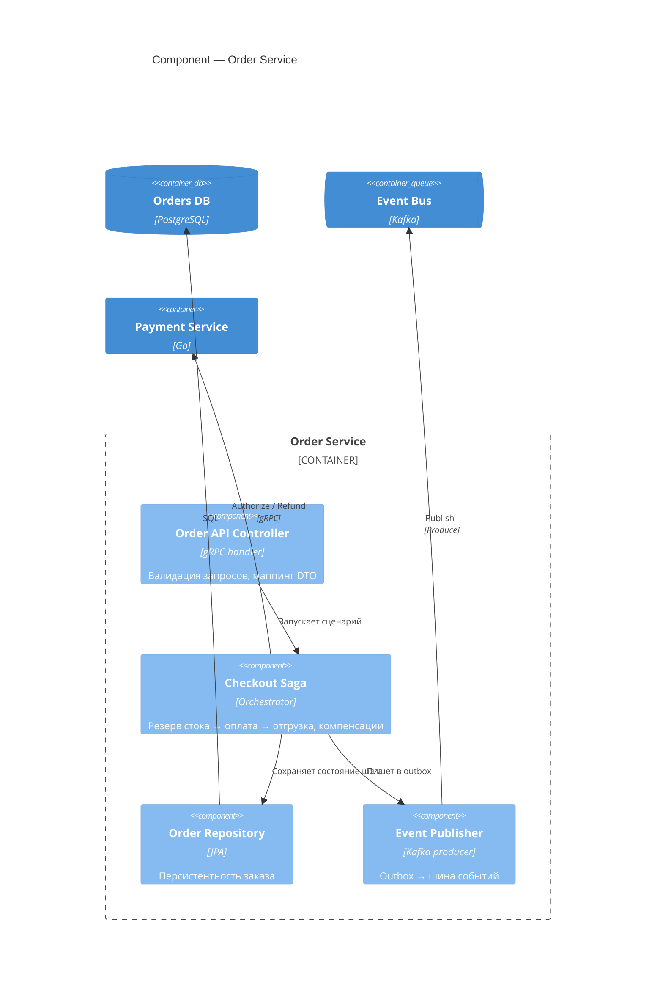

# Диаграммы в GitHub: Mermaid, PlantUML, C4

Инструкция о том, как хранить схемы **в виде текста** (diagram as code) рядом с документацией и получать
картинку прямо в GitHub — без ручного экспорта PNG из Visio/draw.io.

Почему так лучше картинок:
* схема лежит в git → видно историю изменений и `diff` в PR;
* схему можно ревьюить построчно, как код;
* не нужно искать «исходник» диаграммы — исходник и есть файл;
* правится в любом текстовом редакторе.

---

# 1. Что GitHub рендерит сам, а что нет

| Формат | Рендерит ли GitHub сам | Где работает |
|---|---|---|
| **Mermaid** (блок с языком `mermaid`) | ✅ да, из коробки | `.md`-файлы, Issues, Pull Requests, комментарии, Discussions, Wiki |
| **C4 через Mermaid** (`C4Context`, `C4Container`, `C4Component`) | ✅ да (режим помечен как экспериментальный) | там же, где Mermaid |
| **PlantUML** (`.puml`, блок с языком `plantuml`) | ❌ **нет** | нужен внешний рендер — см. раздел 4 |
| **Structurizr DSL** (`.dsl`) | ❌ нет | только внешние инструменты |
| **GeoJSON / TopoJSON**, **ASCII STL**, **LaTeX-формулы** (`$...$`) | ✅ да | `.md`-файлы |
| **AsciiDoc** (`.adoc`) | ✅ рендерится как документ, но **Mermaid внутри `.adoc` не рисуется** | — |

⚠️ Главный вывод: **если хотите, чтобы GitHub нарисовал схему сам, без сторонних сервисов и без коммита
картинок — используйте Mermaid.** PlantUML тоже можно, но через обходные пути (раздел 4).

---

# 2. Mermaid — базовый способ

## 2.1 Как вставить

В `.md`-файле пишем обычный блок кода, но с языком `mermaid`:

````markdown

````

Результат в GitHub:


Ничего устанавливать не нужно: GitHub сам находит блок с языком `mermaid` и заменяет его на SVG.

## 2.2 Диаграмма последовательности (sequence)



<details>
<summary>Исходный текст этой диаграммы</summary>

````markdown

````

</details>

## 2.3 Схема компонентов / развёртывания (flowchart с подграфами)



## 2.4 ER-диаграмма (модель данных)



## 2.5 Диаграмма состояний



## 2.6 Диаграмма классов (UML)



## 2.7 Gantt — план работ / этапы миграции



---

# 3. C4-диаграммы средствами Mermaid

Mermaid умеет C4 напрямую — GitHub такие блоки рендерит. Это самый простой способ положить C4 в репозиторий.

Уровни:
* `C4Context` — Level 1: система, акторы, внешние системы;
* `C4Container` — Level 2: деплоимые единицы (сервисы, БД, очереди, SPA);
* `C4Component` — Level 3: внутреннее устройство **одного** контейнера;
* `C4Dynamic`, `C4Deployment` — сценарии и развёртывание.

## 3.1 Level 1 — System Context



## 3.2 Level 2 — Container



## 3.3 Level 3 — Component (раскрываем Order Service)



⚠️ Особенности C4 в Mermaid:
* автолэйаут иногда «разъезжается» — управляйте им через `UpdateLayoutConfig($c4ShapeInRow=..., $c4BoundaryInRow=...)`;
* уровни **не смешивать**: на Context нет сервисов и БД, на Container нет классов;
* режим официально экспериментальный, синтаксис может меняться — держите схемы простыми.

Готовые примеры C4/UML/ADR по трём системам лежат в
[`Lessons/14 - Документирование архитектуры. ADR, C4, arc42/examples`](../../Lessons/14%20-%20Документирование%20архитектуры.%20ADR%2C%20C4%2C%20arc42/examples).

---

# 4. PlantUML в GitHub

GitHub **не рендерит** PlantUML сам — блок с языком `plantuml` покажется просто текстом.
Есть три рабочих способа получить картинку.

## Способ A (рекомендуемый) — PlantUML Proxy: картинка из `.puml`-файла

1. Кладём исходник схемы в репозиторий, например `docs/diagrams/containers.puml`.
2. В `.md` вставляем картинку через публичный сервер PlantUML, который сам скачает файл по `raw`-ссылке:

```markdown

```

Параметры:
* `src=` — **raw**-ссылка на `.puml` (обязательно `raw.githubusercontent.com`, а не адрес страницы GitHub);
* `fmt=svg` — векторный вывод (можно `png`);
* `cache=no` — чтобы сервер не отдал старую версию после правки.

Как получить raw-ссылку: открыть `.puml` в GitHub → кнопка **Raw** → скопировать адрес из строки браузера.

⚠️ Ограничения способа A:
* **работает только для публичных репозиториев** — приватный файл сервер PlantUML скачать не сможет;
* исходник уходит на внешний сервис `plantuml.com` (для рабочих проектов поднимают свой:
  `docker run -d -p 8080:8080 plantuml/plantuml-server:jetty`, и меняют домен в ссылке);
* если сервис недоступен — в документе будет «битая» картинка.

## Способ B — закодированная диаграмма прямо в ссылке

Текст диаграммы сжимается и кодируется в саму URL, отдельный файл не нужен:

```markdown

```

Получить такую ссылку: открыть <https://www.plantuml.com/plantuml/uml/>, вставить текст, скопировать адрес.

Минус: исходник больше не читается в git-диффе — по сути та же картинка. Годится для одноразовых мелких схем.

## Способ C — генерация SVG на CI и коммит результата

Самый надёжный вариант для приватных репозиториев: GitHub Action рендерит `.puml` → `.svg`,
коммитит SVG обратно, а в Markdown ссылаемся на готовый файл.

`.github/workflows/plantuml.yml`:

```yaml
name: Render PlantUML
on:
  push:
    paths: ['**/*.puml']

jobs:
  render:
    runs-on: ubuntu-latest
    permissions:
      contents: write
    steps:
      - uses: actions/checkout@v4

      - name: Render diagrams
        uses: cloudbees/plantuml-github-action@master
        with:
          args: -v -tsvg docs/diagrams/*.puml

      - name: Commit rendered SVG
        run: |
          git config user.name  "github-actions[bot]"
          git config user.email "github-actions[bot]@users.noreply.github.com"
          git add docs/diagrams/*.svg
          git diff --staged --quiet || git commit -m "chore: re-render PlantUML diagrams"
          git push
```

В документе после этого просто:

```markdown

```

## 4.1 Пример исходника PlantUML

Файл `docs/diagrams/sequence.puml`:

```
@startuml
title Оформление заказа

actor Пользователь as U
participant "API Gateway" as API
participant "Order Service" as ORD
participant "Payment Service" as PAY
queue Kafka as Q

U -> API : POST /orders
API -> ORD : CreateOrder
ORD -> PAY : Authorize(amount)
alt Оплата прошла
    PAY --> ORD : OK
    ORD -> Q : OrderCreated
    ORD --> API : 201 Created
else Отказ банка
    PAY --> ORD : Declined
    ORD --> API : 402 Payment Required
end
API --> U : Ответ
@enduml
```

## 4.2 C4 в PlantUML (библиотека C4-PlantUML)

PlantUML даёт более «каноничный» C4, чем Mermaid, — через подключаемую библиотеку:

```
@startuml
!include https://raw.githubusercontent.com/plantuml-stdlib/C4-PlantUML/master/C4_Container.puml

title Container — Маркетплейс

Person(buyer, "Покупатель")
System_Boundary(mp, "Маркетплейс") {
    Container(spa, "Web SPA", "React", "Витрина")
    Container(api, "API Gateway", "Go", "Аутентификация, роутинг")
    Container(order, "Order Service", "Java", "Заказы и сага оформления")
    ContainerDb(pg, "Orders DB", "PostgreSQL", "Заказы")
    ContainerQueue(bus, "Event Bus", "Kafka", "События")
}
System_Ext(psp, "Платёжный провайдер")

Rel(buyer, spa, "HTTPS")
Rel(spa, api, "HTTPS/JSON")
Rel(api, order, "gRPC")
Rel(order, pg, "SQL")
Rel(order, bus, "Produce")
Rel(order, psp, "HTTPS")
@enduml
```

⚠️ `!include` по внешней ссылке требует, чтобы у сервера рендеринга был доступ в интернет.
На своём сервере часто отключают внешние include — тогда библиотеку кладут в репозиторий рядом.

---

# 5. Что выбрать

| Задача | Чем делать |
|---|---|
| Схема в README / в описании PR / в комментарии к ревью | **Mermaid** |
| Домашнее задание, которое проверяют прямо в GitHub | **Mermaid** (гарантированно отрисуется у ревьюера) |
| C4 «на быструю руку», без внешних сервисов | **Mermaid C4** |
| Сложный C4 с легендой, тегами, аккуратной вёрсткой | **PlantUML + C4-PlantUML**, способ A или C |
| Приватный репозиторий | **Mermaid**, либо PlantUML способом C (рендер на CI) |
| Схема, которую нужно вставлять в презентацию/Word | Mermaid/PlantUML → экспорт в SVG/PNG |

Для домашних заданий курса по умолчанию используем **Mermaid** — он не требует ни внешних сервисов,
ни CI, и ревьюер видит картинку сразу.

---

# 6. Как проверить схему до коммита

* **Mermaid Live Editor** — <https://mermaid.live> : вставили текст — сразу видно результат и место ошибки.
* **PlantUML Online** — <https://www.plantuml.com/plantuml/uml/> .
* **VS Code** (расширения ставятся так же, как в [инструкции по GitHub](../01%20-%20Работа%20с%20гитхабом/README.md)):
  * `Markdown Preview Mermaid Support` — Mermaid в превью Markdown (`Ctrl+Shift+V`);
  * `PlantUML` (jebbs) — превью `.puml` по `Alt+D`;
  * `Markdown All in One` — оглавление и навигация.
* Проверка «ровно как в GitHub»: откройте черновик в **Issue** своего репозитория и нажмите **Preview** —
  рендер там тот же самый, но коммитить ничего не нужно.

---

# 7. Частые ошибки

| Симптом | Причина / решение |
|---|---|
| Вместо схемы виден её текст | Не указан язык блока. Нужно ровно `mermaid` — без пробела и без заглавных букв |
| Вместо схемы — блок «Unable to render rich display» | Синтаксическая ошибка Mermaid. Проверьте текст в <https://mermaid.live> — там укажут строку |
| Схема не появилась в `.adoc`-файле | GitHub не рендерит Mermaid внутри AsciiDoc. Перенесите схему в `.md` |
| Русский текст ломает разметку | Берите подписи в кавычки: `A["Сервис заказов"]`, `Person(u, "Покупатель")` |
| Скобки и двоеточия в подписи ломают схему | Кавычки, а при необходимости HTML-entity: `#40;` `#41;`; перенос строки — `<br/>` |
| PlantUML-картинка не грузится | Ссылка не `raw.githubusercontent.com`, репозиторий приватный, или нет `cache=no` |
| Схему поправили, а картинка старая | Кэш PlantUML-сервера — добавьте `&cache=no`; кэш браузера — обновите страницу `Ctrl+F5` |
| Диаграмма огромная и нечитаемая | Разбейте по уровням C4 или вынесите часть в отдельный файл; `flowchart LR` часто компактнее, чем `TB` |

---

# 8. Чек-лист перед PR

- [ ] Схема лежит **текстом** — в `.md` (Mermaid) или в `.puml` рядом с документом, а не только картинкой.
- [ ] Блок помечен языком `mermaid`, и схема отрисовалась в превью GitHub.
- [ ] У диаграммы есть заголовок, и понятно, какой это уровень (Context / Container / Component).
- [ ] На стрелках подписаны протокол и назначение (`gRPC`, `HTTPS`, `Produce`), а не просто линия.
- [ ] Уровни C4 не смешаны.
- [ ] Если использовался PlantUML-proxy — картинка проверена глазами на открытой странице PR.
- [ ] Для приватного репозитория PlantUML-proxy не используется.
